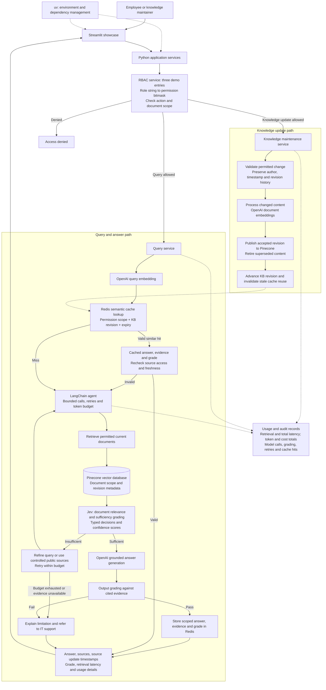

# Enterprise IT Support Copilot: Original Architecture Draft

This document preserves the original design proposal. For the current high-level client and search-tool flow, open the app's **Architecture** page or the [interactive system overview](diagrams/system.html). See [architecture-page.md](architecture-page.md) for implementation scope and regeneration. The original Redis cache proposal below differs from the current Mem0 report reuse implementation.

## Constraints

- Package and environment management: uv.
- Agent library: LangChain.
- Showcase frontend: Streamlit.
- Semantic query/answer cache: Redis, supporting reuse for sufficiently similar queries.
- Embedding and generation provider: OpenAI.
- Vector database: Pinecone.
- Document grading verification: TypeSafe AI's Jev, used for structured relevance and sufficiency decisions with confidence scores. OpenAI remains the embedding and answer generation provider.
- Initial RBAC: Alice (`employee`), Bob (`contributor`), and Mice (`administrator`) are seeded once in SQLite through `src/db/auth`. Users, role permission masks and scopes are read from the database. Ingestion enforces write permission, namespace scope and submitted document roles; query/cache checks and authoritative existing-document ACL checks remain to be integrated with their respective workflows.

## Architecture

## Diagram Notes

- Similarity alone cannot authorize cache reuse. Cached content must match the caller's effective access scope, current knowledge revision, and freshness requirements. A failed validation follows the retrieval path.
- A cache hit reuses a previously graded answer only while its evidence remains valid. Record the original generation and grading provenance separately from the current request's timing, token usage, and cost.
- Enforce bitwise permission checks in the service layer: `(granted_permissions & required_permissions) == required_permissions`. Document scope must also be checked; an action bit alone does not grant access to every document. Demo role selection is not production authentication.
- Record source last-updated timestamps separately from retrieval timestamps; use "unknown" when a source's update time is unavailable.
- Failed or partially applied knowledge updates must not expose a mixed revision as current. Cache reuse must stop for affected knowledge until publication and invalidation are consistent.
- Track build/test/evaluation costs separately from runtime query and knowledge update costs. Include embeddings, generation, grading, retries, external services, and cache lookup costs where applicable; label estimates clearly.
- Numerical similarity thresholds, token budgets, retry limits, grading thresholds, and latency targets are not fixed by this draft.
- Jev supplies structured grading decisions; the application applies agreed acceptance thresholds. Confidence is not a guarantee of factual correctness. Output grading remains required; its evaluator is still to be selected. If Jev is unavailable, report the grading limitation rather than bypassing the document evidence check.
- A durable home for source documents, revision history, and audit/usage records is still to be selected. The diagram does not assume Redis or Pinecone alone supplies all of these records.

## Reference

- [TypeSafe AI: Introducing System One Models & Jev](https://typesafe.ai/blog/introducing-system-one-models-and-jev) describes Jev's typed decision outputs and confidence scores. Applying it to document relevance and sufficiency grading is the proposed design for this project, to be validated against representative IT support queries.
